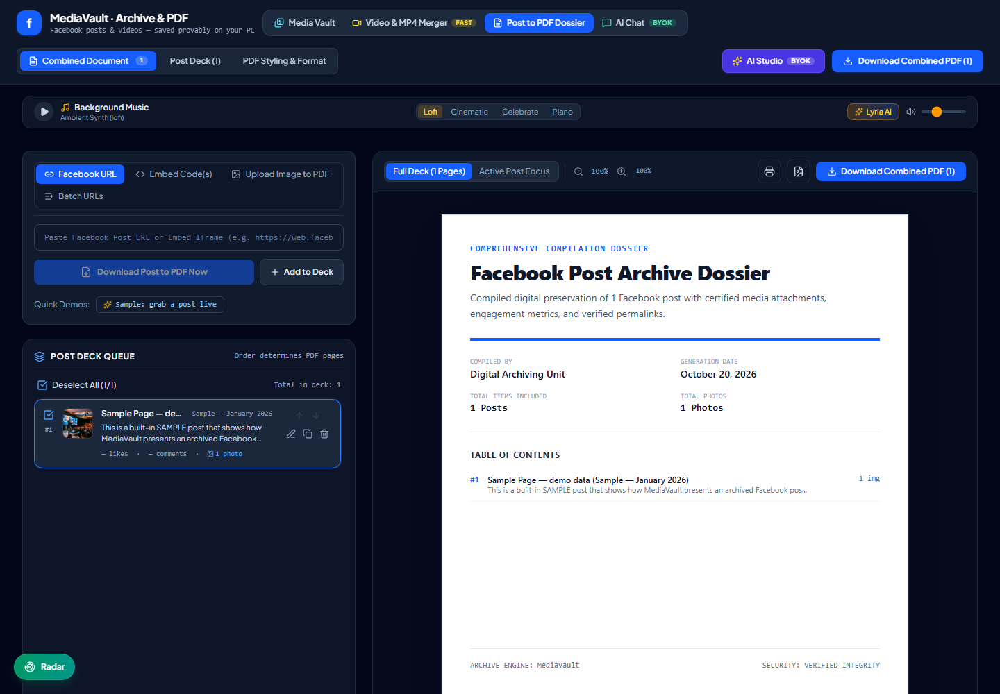
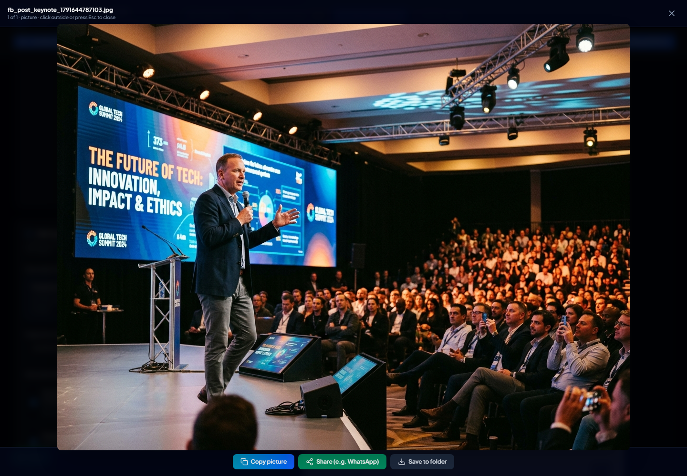
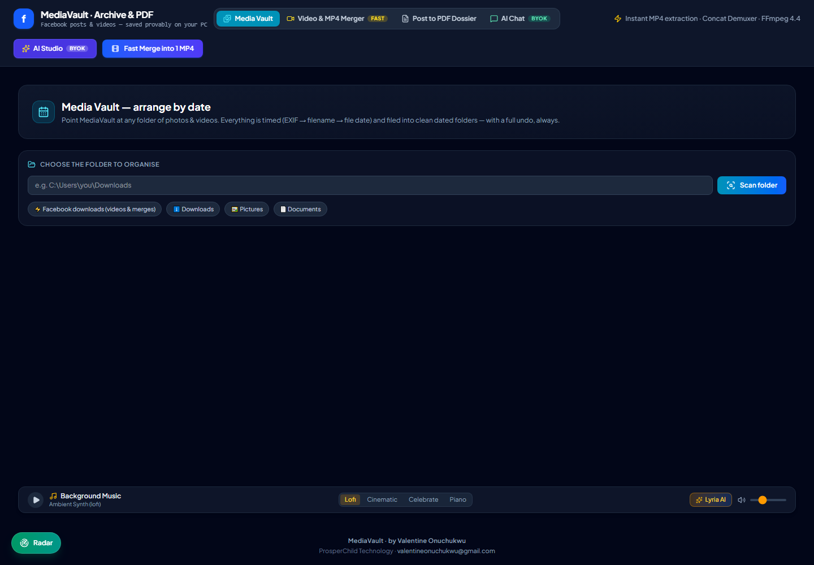

# MediaVault

**Archive it. Prove it. Keep it. — on your own PC.**

[](https://github.com/valentineonuchukwu48-ship-it/mediavault/releases)
[](https://github.com/valentineonuchukwu48-ship-it/mediavault/actions/workflows/ci.yml)
[](https://github.com/valentineonuchukwu48-ship-it/mediavault/releases)
[](https://github.com/valentineonuchukwu48-ship-it/mediavault/releases)
[](https://github.com/valentineonuchukwu48-ship-it/mediavault/blob/main/docs/DOCUMENTATION.md)

|  |
|:---:|
| *Posts become tamper-evident PDF dossiers — cover, table of contents, QR verification.* |

|  |  |
|:---:|:---:|
| ***Click any item** → fullscreen → copy to clipboard (paste into WhatsApp), share, or save.* | *Media Vault: search your folders by name/date, arrange everything by date — with undo.* |

**MediaVault** is a **local-first media vault** for your photos, videos and important documents — built by [Valentine Onuchukwu](https://github.com/valentineonuchukwu48-ship-it) (ProsperChild Technology). Everything runs on your own machine: no account, no server, your files never leave your computer.

> 🕰️ **Born as a Facebook archiver.** MediaVault started as a tool to archive Facebook posts into tamper-evident PDFs and download videos with sound. It's now growing into the private vault for your whole digital life — and the Facebook archival features you rely on are all still here.

---

## ✨ What MediaVault does today

| Feature | About |
|---|---|
| 📄 **Facebook post → PDF archiver** | Preserve posts as tamper-evident PDFs with a verification QR code and a hash-chained **Evidence Vault** you can prove existed on a specific date (OpenTimestamps). |
| 🎬 **Video downloader & merger** | Grab Facebook Reels/watch videos and merge many clips into one high-definition MP4 — with sound. |
| 👆 **Click → popup → copy / share / save** | Click any searched photo or video (or any photo in a saved post): fullscreen popup with **Copy** (paste straight into WhatsApp), **Share** (native share sheet) and **Save to folder** — videos play right in the popup. |
| 🤖 **AI Studio** | Optional script drafting and AI chat (bring your own API key). |
| 📱 **Phone Connect** | The full app on your phone over Wi-Fi — plus a native **Android companion APK**. |
| 🔐 **Evidence Vault** | Every archived entry is hash-chained, exportable to CSV/Excel, and provable against the public Bitcoin calendar. |
| 🖥️ **Desktop + Mobile** | Windows (installer & portable), macOS, Linux, Android APK. |

## 🛣️ In development — the vault grows (v2.0)

- 📁 **Media organizer** — photos & videos grouped automatically **by date and event**
- 🔍 **Duplicate finder** — exact and look-alike copies found with one scan, removed safely after preview
- 💰 **Watch-only portfolio tracker** — track holdings and value; your keys never touch MediaVault and never will (this is a display tool, not a wallet)

---

## 📥 Install

### Windows

1. Go to the [**Releases**](https://github.com/valentineonuchukwu48-ship-it/mediavault/releases) page
2. Download **`MediaVault-<version>-x64-setup.exe`** (installer) or **`MediaVault-<version>-portable.exe`** (no install needed)
3. SmartScreen may warn on first run because this build is **unsigned** (a code-signing certificate costs money). Click **More info → Run anyway**.

### macOS

Download **`MediaVault-<version>-arm64.dmg`** (Apple Silicon: M1/M2/M3/M4), then right-click the app → **Open** the first time (unsigned build).

### Linux

Download the **`.AppImage`** (any distro) or **`.deb`** (Debian/Ubuntu) from the [Releases](https://github.com/valentineonuchukwu48-ship-it/mediavault/releases) page.

### 📱 Android (native companion)

1. Download **`MediaVault-Mobile-<version>.apk`** from the [Releases](https://github.com/valentineonuchukwu48-ship-it/mediavault/releases) page
2. Allow "Install unknown apps" for your browser once (Android asks because the build is unsigned)
3. Open the APK → it shows its own pairing screen
4. On your PC: **Desktop panel → Phone Connect → Share to my phone**, type the address & pairing code into the Android app
5. Done — the app remembers your PC, and videos download straight to the phone's Downloads folder

*Prefer no install at all? Phone Connect also opens the full desktop UI in your phone's browser — scan the QR in the Desktop panel.*

### iPhone (Safari)

Turn on **Phone Connect** on the PC, scan the QR, then use **Share → Add to Home Screen**.

---

## 🙏 Responsible use

MediaVault is built to help you **keep what's yours**: your saved posts, your videos, your receipts. Please don't use it to access other people's private content without their permission. Respect creators and the law where you live.

## ☁️ Privacy — why people trust it

- No account, no login, no telemetry
- AI keys, cookies and data live in your own user profile folder
- The only network requests are the ones you click (Facebook/AI provider/timestamps)

---

## 📚 Full documentation

The complete manual lives in **[docs/DOCUMENTATION.md](docs/DOCUMENTATION.md)** — how every feature works (vault hash math, video merging, pairing, security model).

## 🛠️ For developers

```bash
git clone https://github.com/valentineonuchukwu48-ship-it/mediavault.git
cd mediavault
npm install
npm run dev          # engine on http://localhost:3000
npm test             # test suite
npm run dist:win     # package the Windows installer
```

*(JDK 17 required to build the Android companion APK.)*

## 💛 Support

Free forever, MIT licensed. If it saves you time: [buy me a coffee](https://flutterwave.com/donate/fysqhtbnfznn)

---

© 2026 Valentine Onuchukwu — ProsperChild Technology · valentineonuchukwu@gmail.com · MIT License
